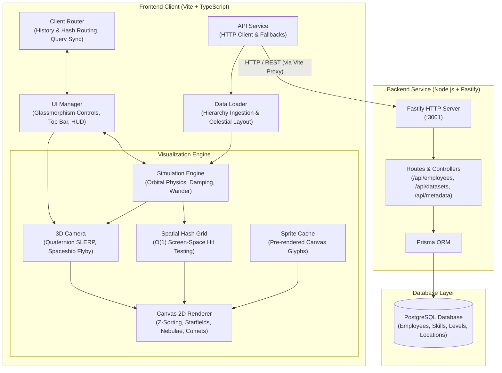

# 🪐 Orbital Particle System — High Performance 3D Data Visualization

A high-performance, interactive 3D orbital particle system designed to visualize complex organizational structures, reporting hierarchies, individual skill matrices, and global talent locations. Built with TypeScript, HTML5 Canvas, and a dedicated Fastify + Prisma backend API, this project fuses astrodynamic physics simulation, quaternion-driven camera choreography, offscreen sprite caching, spatial acceleration structures, and deep-link routing into a cinematic 60 FPS real-time experience.

---

## 🌟 Key Features & 3D Realism

### 🚀 Cinematic 3D "Spaceship" Flyby & Orientation
- **Quaternion SLERP & Basis Tracking**: Transitions smoothly navigate 3D space using Spherical Linear Interpolation (`slerpQuaternion` and `slerpVector`). 
- **Face-On System Alignment**: Orbits rotate along dynamically inclined 3D planes (`basisU`, `basisV`, and normal `n`). When flying toward a sideways or tilted cluster, the camera approaches the cluster obliquely, then gracefully swoops and rotates to face the orbital disk squarely from the front.
- **Dynamic Orbital Target Tracking**: As supervisees orbit their leaders in real-time, the camera tracks moving targets during flight and dampens arrival velocity with custom cubic easing (`easeInOutCubic`).
- **Fly Me / Galaxy Picker**: Dedicated cosmic navigation menu in the top app bar listing all galaxy clusters, director metadata, and population counts, allowing instant one-click interplanetary flybys.

### 🌌 Deep Space Realism & Multi-Layered Celestial Environment
- **Multi-Layer Parallax Starfield**: Over 1,100 stars distributed across three distinct depth planes:
  - *Deep Cosmic Dust (~750 micro-stars)*: Ultra-subtle background parallax with gentle scintillation.
  - *Midground Navigation Stars (~350 stars)*: Spectral color variety (O-B blue giants to M red dwarfs) with phase-shifted twinkle mechanics.
  - *Foreground Sparkling Beacons (~45 bright stars)*: Multi-point diffraction spikes, coronas, and prominent depth parallax.
- **Dynamic Deep-Space Nebulae**: Volumetric multi-lobed interstellar gas clouds (e.g., *Carina Veil*, *Orion Core*, *Cygnus Void*) featuring harmonic respiration pulses, organic orbital drift, and embedded luminous protostars.
- **Cosmic Comets**: Transient celestial bodies streaking through 3D space with velocity-stretched heads, luminous dust cores, and fading ion tails.
- **Fibonacci Celestial Distribution**: Galaxy clusters are spaced across expansive 3D coordinates using golden-angle celestial sphere distribution, with generous separation scaling according to viewport diagonals and aspect ratios.

### ⚛️ Astrodynamic Orbital Physics & Hierarchical Mechanics
- **Hierarchical Gravitational Orbits**: Supervisees orbit supervisors along inclined 3D ellipses. Elliptical eccentricities, orbital inclination angles, precession, and velocities are calculated organically from organizational depth and supervisor system mass.
- **Kinematic Wander & Sector Anchors**: Root directors drift organically using low-frequency Brownian wander forces while soft harmonic spring vectors (`homeX`, `homeY`, `homeZ`) prevent cluster collisions and maintain sector stability.
- **Interactive Particle Dragging**: Dragging a node in 3D unprojects screen mouse coordinates through the camera's full 3D orthonormal basis, enabling natural manipulation at the particle's true depth.

### ⚡ Extreme Performance & Graphics Pipeline
- **Offscreen Sprite Caching (`SpriteCache`)**: Multi-ring concentric particle glyphs (core avatar glyphs, location rings, skill distribution arcs, and proficiency tiers) are pre-rendered into cached offscreen canvases, minimizing draw overhead to ultra-fast single blit calls.
- **2D Spatial Hash Grid (`SpatialHashGrid`)**: O(1) screen-space partition bucket grid delivering instantaneous hover detection, ray-casting, and click selection across thousands of concurrent particles.
- **Adaptive Level-of-Detail (LOD)**: Particle designations, names, orbital trajectories, and glow halos dynamically adapt based on camera distance and projection scale (`projScale`), preserving visual clarity and frame rates.
- **Depth-Sorted Blit**: Nodes and link vectors are Z-sorted every frame so foreground bodies naturally occlude background systems, complete with atmospheric depth fogging.

### 📍 Location Intelligence & Multi-Dimensional Filtering
- **Interactive Location Hub**: Multi-select dropdown filtering particles across worldwide hub offices (e.g., Tokyo, London, San Francisco, New York, Bengaluru, Sydney).
- **Cosmic Respiration Halos**: Highlighted location particles emit radiant chromatic glow halos and harmonic size pulses.
- **Cluster Summary Badges**: Galaxy roots dynamically display floating count badges indicating the exact number of matching team members within their system.

### 🔗 Deep-Linked Client-Side Routing & State
- **History & Hash Mode Routing**: Seamlessly switch between views:
  - `/project` or `/#/project`: Focused sub-team visualization (6 nodes).
  - `/team` or `/#/team`: Full organizational galaxy visualization (64 nodes).
- **Persistent Node State (`?node=ID`)**: Direct URL links trigger an automatic camera flyby approach, selection pulse, and inspector drawer presentation.

---

## 🏛️ System Architecture



---

## 🏗️ Architecture & Project Structure

```text
├── index.html                   # Main application markup & glassmorphic UI controls
├── package.json                 # Root dependencies, concurrent dev & build scripts
├── tsconfig.json                # Frontend TypeScript configuration
├── vite.config.ts               # Vite build configuration with /api proxy to backend
├── server/                      # Backend API service (Fastify + Prisma)
│   ├── .env                     # Database connection string and server port config
│   ├── package.json             # Backend dependencies and Prisma scripts
│   ├── tsconfig.json            # Server TypeScript configuration
│   ├── prisma/
│   │   ├── schema.prisma        # Database schema (Employee, Skill, Level, Location, SystemConfig)
│   │   ├── seed.ts              # Database seeder for organizational and project datasets
│   │   └── seedStress.ts        # Database stress-testing seed scripts
│   └── src/
│       └── index.ts             # Fastify server bootstrap, routes, and Prisma queries
├── src/                         # Frontend client application
│   ├── main.ts                  # Application bootstrap, routing hooks & animation loop
│   ├── types.ts                 # TypeScript interfaces for nodes, catalogs, and engine state
│   ├── style.css                # Modern dark-theme styling, glassmorphism, and responsive layout
│   ├── router/
│   │   └── Router.ts            # SPA history & hash routing with query parameter support
│   ├── services/
│   │   └── ApiService.ts        # Frontend HTTP service communicating with the backend API
│   ├── data/
│   │   ├── DataLoader.ts        # Data ingestion, hierarchy parsing, and orbital calculations
│   │   ├── metadata.ts          # Fallback skill catalogs, level tiers, location color definitions
│   │   ├── projectData.ts       # Fallback project dataset (6 nodes)
│   │   └── teamData.ts          # Fallback organizational dataset (64 nodes)
│   ├── engine/
│   │   ├── Camera.ts            # 3D view camera, quaternion SLERP, spaceship approach & zoom
│   │   ├── Simulation.ts        # Physics loop, orbital mechanics, and wander forces
│   │   ├── Renderer.ts          # Canvas draw pipelines, celestial starfield, nebulae, comets
│   │   ├── SpriteCache.ts       # Cached offscreen canvas generation for node glyphs
│   │   └── SpatialHashGrid.ts   # Spatial acceleration structure for hit testing & interactions
│   └── ui/
│       └── UIManager.ts         # HUD bindings, galaxy picker, location filter, inspector drawer
```

---

## 🔌 API Server & Endpoints

The backend is built with [Fastify](https://fastify.dev/) and [Prisma ORM](https://www.prisma.io/) connected to PostgreSQL:

| Method | Endpoint | Description |
| :--- | :--- | :--- |
| `GET` | `/api/health` | Healthcheck and database connection status |
| `GET` | `/api/metadata` | Skills, levels, locations, and physics configuration rules |
| `GET` | `/api/datasets/:type` | Fetch full dataset records (`project` or `team`) |
| `GET` | `/api/employees/:empID` | Fetch a single employee record by ID |
| `POST` | `/api/employees` | Create or upsert an employee record |
| `PUT` | `/api/employees/:empID` | Update an existing employee record |
| `DELETE` | `/api/employees/:empID` | Delete an employee record |

---

## 🚀 Getting Started

### Prerequisites

- [Node.js](https://nodejs.org/) (version 18+ recommended)
- [PostgreSQL](https://www.postgresql.org/) running locally or accessible via network
- `npm` or any modern package manager (`pnpm`, `yarn`)

### Installation & Database Setup

1. **Clone the repository:**
   ```bash
   git clone https://github.com/subzw0rld/datavisualization.git
   cd ParticleSystemOptimisationApproach
   ```

2. **Install frontend and backend dependencies:**
   ```bash
   # Install root dependencies
   npm install

   # Install server dependencies
   cd server && npm install && cd ..
   ```

3. **Configure environment & database:**
   Configure `server/.env` with your PostgreSQL database URL (or copy from `server/.env.example`):
   ```env
   DATABASE_URL="postgresql://<user>:<password>@localhost:5432/particle_viz?schema=public"
   PORT=3001
   HOST=0.0.0.0
   ```

4. **Initialize database schema and seed data:**
   ```bash
   cd server
   npm run db:push
   npm run db:seed
   cd ..
   ```

### Running Locally

Start both the backend API server and the frontend client concurrently:
```bash
npm run dev
```

- **Backend API**: Runs at `http://localhost:3001`
- **Frontend App**: Runs at `http://localhost:5173` (with Vite proxy forwarding `/api` calls to `:3001`)

Alternatively, run each service independently:
```bash
# Terminal 1: Backend
npm run dev:backend

# Terminal 2: Frontend
npm run dev:frontend
```

### Building for Production

Compile both the backend TypeScript server and frontend static bundle:
```bash
npm run build
```

Preview the frontend production bundle:
```bash
npm run preview
```

---

## 🎮 Navigation & Controls

| Interaction / Key | Action |
| :--- | :--- |
| **Left Click + Drag** (on background) | Orbit / rotate camera orientation in 3D space |
| **Right Click + Drag** / **Shift + Drag** | Pan camera across the 3D plane |
| **Scroll Wheel / Pinch** | Cursor-anchored Zoom in / Zoom out |
| **Left Click** (on node) | Fly camera to node with front-facing alignment and open inspector drawer |
| **Double Click** (on background) | Reset camera to cosmic overview |
| **Double Click** (on node) | Instant spaceship focus on particle |
| **Press `/`** | Quick focus on global search bar |
| **Escape** | Deselect active node, close open modals and dropdowns |
| **"Fly Me" Dropdown** | Jump directly to any galaxy cluster with 3D approach animation |
| **"Locations" Dropdown** | Filter and illuminate employees by geographic hub with halo pulses |
| **Center Button** | Recenter camera to cosmic origin |

---

## 🛠️ Tech Stack

- **Frontend Core**: [TypeScript](https://www.typescriptlang.org/)
- **Build Tool**: [Vite](https://vitejs.dev/)
- **Graphics & Rendering**: HTML5 Canvas 2D API with custom 3D projection, Quaternion SLERP & Orthonormal Camera Basis
- **Charts & Metrics**: [Chart.js](https://www.chartjs.org/)
- **Styling**: Modern CSS3 (Glassmorphism, CSS Custom Properties, Flexbox & Grid)
- **Backend Framework**: [Fastify](https://fastify.dev/)
- **ORM & Database**: [Prisma](https://www.prisma.io/) with [PostgreSQL](https://www.postgresql.org/)
- **Process Orchestration**: Concurrently & Wait-on
