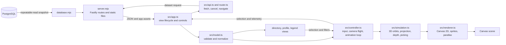

# Orbit — People in perspective

A local TypeScript + Canvas 2D rebuild of [subzw0rld/datavisualization](https://github.com/subzw0rld/datavisualization/tree/494026b1afd3a4154ec8f46ce6518a172a4f2e64). Both original datasets and their ring meanings are retained. The original repository is untouched; the analysis is in `reports/particle-system-analysis.md`.

Orbit turns a reporting hierarchy into a moving constellation. People orbit their supervisors in three-dimensional simulation space, then appear on a two-dimensional canvas through perspective projection. This gives the scene convincing depth while keeping names, relationships, and the directory usable.

## Features

- **Spatial hierarchy:** People orbit their parent nodes on inclined, rotated paths. Root groups drift together, keeping reporting connectors attached as the scene moves.
- **Depth cues:** Perspective changes apparent size, and depth sorting puts nearer people in front. Optional orbit paths are projected from the same 3D positions. Star and grid layers shift at different rates while dragging to add parallax.
- **Fly in 3D:** Choose a root system from the header menu. The camera eases out to an overview, travels to the destination, then zooms in. The flight takes about 8.7 seconds; reduced-motion preference makes the transition immediate. Dragging, zooming, fitting, or focusing a person cancels an active flight.
- **Inspectable people:** Select a node or search the directory to see real skills, proficiency, location, supervisor, and direct reports. Search by name, role, grade, or skill, and filter by location.
- **Scene controls:** Pan, zoom, fit, show orbit paths, adjust speed, pause or resume, toggle the directory, and enter fullscreen. Keyboard controls and reduced-motion behavior support alternative ways to explore.
- **Two dataset views:** Switch between the team and project constellations. The server loads each view from PostgreSQL; the browser validates and normalizes the graph before drawing it.

The 3D effect is a perspective-projected simulation rendered with Canvas 2D. The camera can pan and zoom or follow a scripted flight; it does not offer free rotation around the scene. Motion illustrates the hierarchy rather than measured physical trajectories.

## Run

Requires Node.js 22+ and npm.

```sh
npm install
npm run build
npm start
```

Configure `.env` with `DATABASE_URL`, `HOST`, and `PORT`. The server defaults to `HOST=127.0.0.1` and `PORT=4173`; set `HOST=127.0.0.1` explicitly to keep it local, then open **http://127.0.0.1:4173**. The server connects to PostgreSQL and exposes the datasets through `/api/datasets/team` and `/api/datasets/project`. The API reads a fresh repeatable-read snapshot when a view is loaded; it does not push live updates. The server has no authentication, so only expose it on a trusted network. Location IDs without matching lookup rows are labeled as unknown.

After editing TypeScript, run `npm run build` and refresh. For local live reload, use `npm run dev`; it enables the watcher and reload endpoint only for that process. Production startup uses the existing `dist/` output and requires `DATABASE_URL`.

```sh
npm run check
npm test
```

## Explore

- Switch between **Team view** and **Project view**.
- Click a node or find someone in the directory. Selection shows actual skills, location, supervisor, and direct reports while motion continues; use **Pause motion** to stop it.
- Search by name, role, grade, or skill; combine with a location filter. Nonmatching nodes are dimmed to retain graph context.
- Drag to pan; scroll or use the buttons to zoom. **Fit view** restores the complete overview. Directory selections center and enlarge that person.
- Use **Fly in 3D** to travel to a root particle system; direct interaction cancels the flight.
- Toggle orbit paths, change speed, pause, or resume. Reduced-motion preference starts the scene paused; hidden tabs stop scheduling animation frames.
- Use **Reading the map** for all skill, proficiency, and location colors. Node radius retains the original grade encoding.
- Keyboard: use the directory buttons; on the canvas use Space for motion, arrows for pan, +/− for zoom, and 0 to fit. Escape closes the selected profile.

## Architecture

The browser owns the interactive visualization; the Fastify server serves static files and reads PostgreSQL. Dataset switching changes the URL to `/team-view` or `/project-view`, while both routes serve the same application shell.



| File | Responsibility |
|---|---|
| `src/model.ts` | Validates and copies input; resolves references; builds deterministic parent-first traversal. |
| `src/simulation.ts` | Seeded orbital layout, reserved group bounds, elapsed-time updates, camera and picking geometry. |
| `src/renderer.ts` | Canvas 2D drawing, depth order, viewport culling, connectors, labels, glyph fallbacks, and the bounded 24 MiB sprite cache. |
| `src/controller.ts` | Elapsed-time animation pacing, scripted fly-to-system camera motion, visibility/reduced-motion handling, resize/context recovery, bounded diagnostics, pan/zoom, picking, and teardown. |
| `src/app.ts` | Coordinates dataset loading, visualization lifecycle, controls, fullscreen, and telemetry. |
| `src/api.ts` / `src/router.ts` | Cancelable dataset requests and route navigation. |
| `src/store.ts` / `src/dom.ts` / `src/view-state.ts` | Shared application state and small DOM/screen helpers. |
| `src/directory-view.ts` / `src/profile-view.ts` / `src/legend-view.ts` | Directory, profile, and legend presentation. |
| `src/directory.ts` | Precomputed search metadata, alphabetical ordering, matching, and accessible pages of up to 60 people. |
| `server.mjs` | Serves the app and database-backed dataset API. |
| `database.mjs` | Reads and maps PostgreSQL records in a consistent snapshot. |

Root groups are packed deterministically rather than randomly scattered. Groups drift gently within reserved bounds. Orbital speed depends on particle size and is independent of refresh rate. Large elapsed gaps are clamped to 250 ms; time does not catch up after tab suspension. The pulse is a short outer halo rather than an expansion of all ring artwork. There is no collision simulation, so nodes within nested groups can still overlap; use pause, zoom, and the directory to inspect them.

Avatars are decoded once per unique URL and clipped/scaled explicitly. Missing images retain a drawn silhouette. Sprite keys share identical visual appearances; display scale is capped at DPR 2 and caches are rebuilt for changed geometry/resolution. Tiny particles use location-colored glyphs, while detailed sprites are prioritized for selected/hovered and inspection-scale people. Sprite construction is limited to at most eight canvases per draw with a soft 3 ms budget; pending work continues while paused. The renderer skips offscreen artwork while simulation still updates its ancestors. Connectors crossing the viewport are retained even when their endpoints are outside it. Labels avoid overlapping other labels.

The engine advances from actual elapsed time, clamps unusually large gaps to 250 ms, and resets its clock across pause, visibility, and resume transitions. It adapts frame pacing to measured CPU work, coalesces pointer picking to rendered frames, reuses depth order for picking, and keeps a bounded 240-event diagnostic buffer. Canvas context loss/restoration and repeated draw failures are handled without silently leaving the animation stopped. The directory precomputes search text, coalesces search updates to an animation frame, and paginates instead of rendering every match at once.

The raw JSON records are copied before normalization. Declared headcounts remain separate from children actually present. The four original records with a declared report missing from this subset show that distinction in their profiles. Static example billing charts were replaced with real per-person skill and relationship details. Unused email/client fields were omitted during import.

## Verification and limits

`npm test` currently passes all 22 tests. Coverage includes both original datasets, 5,000-record directory results, immutability/reinitialization, reversed input order, elapsed motion at low and high update rates, hierarchy geometry, transformed/depth picking, offscreen connectors, stable saturated sprite allocation, per-frame sprite-construction limits, no-op resize, context recovery, two independent engine instances, pause/resume, hidden tabs, reduced motion, and teardown. The lifecycle test uses DOM/Canvas stubs; browser checks complement it.

`/assets/qa/mobile.html` embeds the app in a 390 CSS-pixel viewport for a reproducible narrow-layout smoke check. This does not substitute for testing on a physical mobile device.

**Telemetry** shows observed FPS, p95 frame interval, p95 CPU frame work over the last 120 draws, and estimated raw cached pixel memory. It excludes GPU completion, compositor work, layout, garbage collection, and browser resident memory; it is not an FPS benchmark or a before/after speedup claim. The implementation has also been replayed against the captured 5,000-person dataset: overview runs keep all 5,000 people visible without allocating detailed sprites, while a 1,440 × 900 focus scenario reaches about 23.5 MiB with no more than eight sprite constructions per draw. These are harness/browser samples, not guarantees; a controlled 10-minute soak, measured input p95, full GPU/GC profile, and complete browser/device matrix remain future validation work. See [performance-fixes-implementation.md](reports/performance-fixes-implementation.md) and [performance-5000-after.json](reports/performance-5000-after.json) for the evidence and limitations.

Data and avatar provenance: original repository revision `494026b1afd3a4154ec8f46ce6518a172a4f2e64`. The optional `scripts/import-legacy-data.mjs` recreates the JSON and copies the two images from a trusted checkout; it executes those legacy data scripts in a VM and should only be used with the reviewed source.

### Spatial motion

People move in a projected three-dimensional simulation: smaller particles move faster, and reporting relationships remain connected as groups travel. Depth affects apparent size and draw order. The animation is illustrative; the datasets are loaded on demand, not pushed as a live feed. Motion can be paused or adjusted with the existing controls and starts paused when reduced motion is requested.
