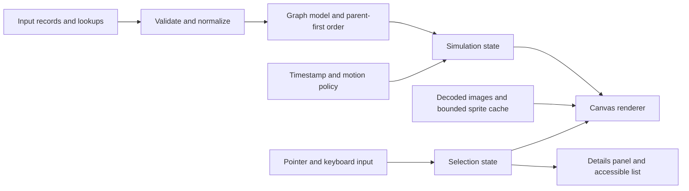

# Particle system: code review and redevelopment approach

**Prepared:** 26 October 2026  
**Repository:** [subzw0rld/datavisualization](https://github.com/subzw0rld/datavisualization)  
**Reviewed revision:** [`494026b1afd3a4154ec8f46ce6518a172a4f2e64`](https://github.com/subzw0rld/datavisualization/tree/494026b1afd3a4154ec8f46ce6518a172a4f2e64), master at the time of review; commit dated 6 May 2019.  
**Scope:** Analysis and proposed implementation. The original application has not been rewritten or modified.

## Recommendation

Rebuild this as a small, modular **animated hierarchy visualization using Canvas 2D**, with a pure data-normalization stage, explicit simulation state, a timestamp-based animation loop, and a renderer that can cache stable node artwork.

The central challenge is broader than making particles move faster. Each node encodes a person, reporting relationships, location, skills, and proficiency. Correct hierarchy updates, selection, and readable layout matter as much as throughput. A fast renderer that clips people out of view or makes them difficult to select would still be a poor visualization.

I would challenge two possible starting assumptions:

- **A different framework or graphics API is not yet justified.** The supplied team view has 64 nodes, and the current algorithm is already linear in nodes, relationships, and skill entries. There is no all-pairs particle interaction to optimize away. First remove unnecessary work and fix correctness; use profiling to decide whether Canvas needs replacing.
- **Continuous orbital movement should be an optional presentation mode.** It makes the visualization distinctive, but makes comparison and selection harder. Preserve it, while adding pause, reduced-motion behavior, and a stable inspection mode. These are proposed product changes, not assumptions about the original intent.

## Evidence and limitations

I read all application JavaScript, both HTML entry points, the shared CSS, the Chart.js version header, and the available image dimensions. I opened the original team page locally and inspected its rendering and captured browser errors. That snapshot returned no captured warnings or errors; it is not proof that every path is error-free.

I also executed the original engine and both datasets in a Node VM with deterministic randomness and stubbed DOM, Canvas, and Image APIs. These probes verify state transitions and count drawing API calls. **They do not measure rasterization, image decoding, GPU cost, frame rate, or memory consumption in a browser.** No percentage speedup is claimed.

Reproduction files in this report folder:

- [audit-particle-system.mjs](/Users/subroto/Documents/Projects/DataVisualisation-Enhancement/reports/audit-particle-system.mjs): source-level execution probes, including assertions for several confirmed failures.
- [audit-results.json](/Users/subroto/Documents/Projects/DataVisualisation-Enhancement/reports/audit-results.json): captured results, source revision, runtime, and methodology.
- [original-team-view.png](/Users/subroto/Documents/Projects/DataVisualisation-Enhancement/reports/original-team-view.png): browser screenshot of the original team view. Its random layout is illustrative, not a deterministic comparison baseline.

Run the probes against a checkout of the reviewed revision:

```sh
node reports/audit-particle-system.mjs /path/to/datavisualization
```

### Dataset and workload inventory

| Measurement | Project view | Team view |
|---|---:|---:|
| Nodes | 6 | 64 |
| Roots / reporting edges | 1 / 5 | 9 / 55 |
| Total skill entries | 23 | 139 |
| Unique avatar paths | 1 | 2 |
| Image objects created | 6 | 64 |
| Arc calls per ordinary draw | 110 | 748 |
| Fill calls per ordinary draw | 58 | 406 |
| Edge strokes per draw | 5 | 55 |
| Image draws / console logs per draw | 6 / 6 | 64 / 64 |

The exact counts above come from executing the first draw, including calls with invalid coordinates. The normal subsequent draw follows the same call structure. At 60 animation draws per second, the team view would issue **44,880 arc calls, 24,360 fills, and 3,840 console logs per second**. Those are arithmetic workload estimates, not observed throughput.

For N nodes, E edges, and S total skill entries, drawing makes `3N + 4S` arc calls and `2N + 2S` fills. Update and rendering work are **O(N + E + S)**; picking is **O(N)** per click. The draw loop does not repeatedly allocate every skill or image: those allocations happen during initialization.

## Findings, ordered by priority

Priority indicates the recommended implementation order. “Confirmed” means directly demonstrated by the probes or source; estimated performance effects still need measurement.

### 1. Source data is mutated, so initialization is not repeatable — high, confirmed

`Object.assign(data)` returns the existing object; it does not clone it. `dataModel()` then replaces location IDs and skill IDs with objects and adds positions, image objects, and animation fields. Running initialization and drawing again fails in both datasets with `TypeError: Cannot read properties of undefined (reading 'color')`.

Changing this to `Object.assign({}, data)` alone would still share the nested person records. Instead, construct new normalized records from the input and keep runtime coordinates and images separately. Test that normalization leaves the source unchanged and gives equivalent results on repeated calls. [Source: dataModel, lines 52–105](https://github.com/subzw0rld/datavisualization/blob/494026b1afd3a4154ec8f46ce6518a172a4f2e64/assets/js/particle-system.js#L52-L105); [Object.assign semantics](https://developer.mozilla.org/en-US/docs/Web/JavaScript/Reference/Global_Objects/Object/assign).

### 2. Hierarchy positioning depends on employee-ID enumeration order — high, confirmed

Position calculation happens inside rendering. Some children are visited before a non-root parent has coordinates. In the supplied team data, IDs **615605, 655609, 662775, and 663428** have non-finite positions on the first draw, causing 52 drawing calls with non-finite arguments. They become finite on the second draw, but those children then use the parent's previous-frame position because the parent is updated later in the same pass.

Build parent indices and child lists once, validate the graph, and update positions in parent-before-child order before drawing anything. Keep draw order independent, so connectors can be behind nodes. [Source: position calculation, lines 130–157](https://github.com/subzw0rld/datavisualization/blob/494026b1afd3a4154ec8f46ce6518a172a4f2e64/assets/js/particle-system.js#L130-L157).

### 3. Motion and selection feedback depend on frame rate — high, confirmed

Angles advance by `0.005` per draw; root movement and selection pulse also advance per frame. The probe produces angular changes of 0.30, 0.60, and 0.72 radians after 60, 120, and 144 updates. If those updates occur in one second, higher-refresh displays run the animation faster.

The `currentTime >= 500` condition only introduces an initial delay; it does not throttle the animation to one update every 500 ms because `startTime` is never advanced. Use the animation timestamp, angular velocity in radians/second, and elapsed-time pulse duration. To approximately preserve the 60 FPS orbit speed, start with **0.3 rad/s**, then tune deliberately. Define pause/resume semantics and clamp large elapsed-time gaps so resuming does not teleport nodes. [Source: pulse and angular updates](https://github.com/subzw0rld/datavisualization/blob/494026b1afd3a4154ec8f46ce6518a172a4f2e64/assets/js/particle-system.js#L159-L220), [loop](https://github.com/subzw0rld/datavisualization/blob/494026b1afd3a4154ec8f46ce6518a172a4f2e64/assets/js/particle-system.js#L224-L267); [requestAnimationFrame timing guidance](https://developer.mozilla.org/en-US/docs/Web/API/Window/requestAnimationFrame).

### 4. Picking uses the wrong coordinate space after layout shifts — high, confirmed

Click handling compares viewport `clientX/clientY` directly with canvas positions. The legend moves the wrapper right by 300 px. In the isolated probe, a node at `(100,100)` is selected by an unshifted click but missed at its translated screen position `(400,100)`.

Convert the pointer using the canvas bounding rectangle and logical dimensions; apply the inverse camera transform if zoom/pan is introduced. Choose whether selection includes the outer rings (`baseRadius + 21`) and the animated pulse. Current picking only includes the base circle. Search in reverse visual order and stop after the first hit; the current loop can update the panel repeatedly when nodes overlap. Squared-distance checks avoid square roots, but that is a small improvement compared with fixing coordinates. [Source: click handler](https://github.com/subzw0rld/datavisualization/blob/494026b1afd3a4154ec8f46ce6518a172a4f2e64/assets/js/particle-system.js#L269-L307); [wrapper displacement](https://github.com/subzw0rld/datavisualization/blob/494026b1afd3a4154ec8f46ce6518a172a4f2e64/assets/css/particle-system.css#L27-L35).

### 5. Static artwork and object logging are repeated every frame — high optimization priority

The renderer rebuilds all ring paths and fills even though skills, proficiency, location, and avatar usually remain unchanged. It also logs every person on every draw. Removing or explicitly gating that log is an immediate cleanup; the actual logging overhead varies with the browser and developer tools.

Pre-render a node's stable appearance to a tightly sized canvas and reuse it with `drawImage`. Cache by visual attributes, avatar asset, resolution, and theme, so identical appearances can share artwork. Render the selection pulse separately, or explicitly preserve the old expanding-rings appearance for the selected node. Those choices have different visual results and should not be conflated.

Cache invalidation must cover data changes, image readiness, theme, and display scale. Bound cache memory and release unused assets. This trades repeated vector drawing for image compositing and memory; it is a hypothesis to benchmark, not an automatic win. [Source: drawing hot path](https://github.com/subzw0rld/datavisualization/blob/494026b1afd3a4154ec8f46ce6518a172a4f2e64/assets/js/particle-system.js#L182-L217); [Canvas pre-rendering guidance](https://developer.mozilla.org/en-US/docs/Web/API/Canvas_API/Tutorial/Optimizing_canvas).

### 6. Image readiness, dimensions, and fallback handling need explicit ownership — medium, confirmed design gaps

Each person gets a new `Image(60,60)`, despite only two unique team avatar paths. There is no load/decode coordination or error fallback. This creates redundant Image objects; it does **not** establish that the browser downloads the same URL 64 times.

Three-argument `drawImage` uses intrinsic dimensions, while placement subtracts half of the constructor-specified width/height. The supplied images are 50×50 and 60×80, so they are not consistently centered or rendered at 60×60. Use explicit destination dimensions, intentional cropping, and clipping if avatars should fit their nuclei. Cache loading by URL and retain a fallback until decoding succeeds. [Source: image construction and loading](https://github.com/subzw0rld/datavisualization/blob/494026b1afd3a4154ec8f46ce6518a172a4f2e64/assets/js/particle-system.js#L58-L85), [drawing](https://github.com/subzw0rld/datavisualization/blob/494026b1afd3a4154ec8f46ce6518a172a4f2e64/assets/js/particle-system.js#L188-L190); [drawImage dimensions](https://developer.mozilla.org/en-US/docs/Web/API/CanvasRenderingContext2D/drawImage).

### 7. Resizing, display density, and layout bounds are incomplete — medium, confirmed

Canvas dimensions are set once from the window. There is no resize handling or device-pixel-ratio scaling, while movement and clearing continue to read current window dimensions. Fixed orbit radii up to 400 px and randomly placed roots can push nodes outside the viewport. The browser view also shows overlap.

Observe the actual container, maintain logical CSS-pixel coordinates, resize the backing buffer to a chosen pixel ratio, and restore context transforms after resizing. Higher pixel ratios increase pixel area approximately quadratically, so make the quality policy explicit. Compute graph bounds and offer fit-to-view; optional pan/zoom and clustering can support larger datasets. Culling saves drawing work but does not make clipped nodes discoverable. [Source: initialization](https://github.com/subzw0rld/datavisualization/blob/494026b1afd3a4154ec8f46ce6518a172a4f2e64/assets/js/particle-system.js#L110-L119), [orbit and root placement](https://github.com/subzw0rld/datavisualization/blob/494026b1afd3a4154ec8f46ce6518a172a4f2e64/assets/js/particle-system.js#L38-L77).

### 8. The data contract mixes declared counts, graph structure, and movement policy — medium

The current fixtures have no missing supervisors, missing referenced lookup values, or cycles in the probe. However, the implementation does not validate those cases.

Four team records declare one supervisee but have no child records in this dataset: 610120, 613429, 680097, and 682143. This may represent people outside the displayed subset rather than incorrect source data. Keep **reported headcount** separate from **loaded child count**; derive orbit spacing from the actual displayed children. Use exact `2π / childCount` rather than rounded degrees, and explicitly handle zero children.

Initialization identifies roots by missing `supervisor`, but root movement checks `nucleus`. The project dataset's root lacks `nucleus`, so it stays stationary while team roots move. Preserve this as an explicit view policy if intentional. Also guard against dividing by an absent or zero supervisee count in future data. [Source: root initialization and angle calculation](https://github.com/subzw0rld/datavisualization/blob/494026b1afd3a4154ec8f46ce6518a172a4f2e64/assets/js/particle-system.js#L62-L77), [movement predicate](https://github.com/subzw0rld/datavisualization/blob/494026b1afd3a4154ec8f46ce6518a172a4f2e64/assets/js/particle-system.js#L224-L246).

### 9. Global state prevents safe reuse and lifecycle control — medium, confirmed

Selection, pulse state, `firstRun`, speed, and timestamps are shared globals. DOM queries and startup run as soon as the script loads. There is no stop/destroy API, retained animation request ID, or listener cleanup. Multiple instances or reinitialization would interfere.

Use per-instance state and explicit `start`, `pause`, `resume`, `resize`, `setData`, and `destroy` operations. Reset pulse direction and elapsed time on each selection. Render only when invalidated while paused; explicitly suspend when hidden or fully obscured as appropriate. Browser background-tab throttling already exists, so the benefit of lifecycle handling is broader than claiming continuous background drawing today. [Source: globals](https://github.com/subzw0rld/datavisualization/blob/494026b1afd3a4154ec8f46ce6518a172a4f2e64/assets/js/particle-system.js#L1-L24), [automatic startup and scheduling](https://github.com/subzw0rld/datavisualization/blob/494026b1afd3a4154ec8f46ce6518a172a4f2e64/assets/js/particle-system.js#L253-L269).

### 10. Supporting UI and dependencies deserve a separate cleanup — lower rendering priority

Both pages load Chart.js 2.7.2 (159,638 source bytes) and instantiate two charts even though the detail panel starts offscreen. Chart data is static and is not changed by particle selection. Confirm whether those charts are meant to describe a project or the selected person; lazily initialize them when needed. Their impact is principally startup/panel behavior, not proven ongoing particle-frame cost. [Chart setup](https://github.com/subzw0rld/datavisualization/blob/494026b1afd3a4154ec8f46ce6518a172a4f2e64/assets/js/customChart.js#L1-L50).

The timer helpers are not loaded by either entry point, so improving them will not accelerate this animation. Remove unused helpers and globals from the new implementation after checking intended features. Replace script-order coupling with modules and add a reproducible dependency manifest. Test relative asset/navigation paths under a subdirectory deployment: `../assets/js/Object.Assign.js` and the `/` project link are sensitive to the deployment base.

Canvas nodes have no keyboard or screen-reader representation. Provide a searchable DOM list/tree that shares selection with the canvas, focusable controls, Escape-to-close, and reduced-motion support. Legend strings currently use `innerHTML`; use DOM text APIs if they will accept external data. The existing hard-coded strings do not by themselves demonstrate an injection exploit.

## Proposed implementation

Use TypeScript with ES modules for clearer contracts and refactoring support. That is a maintainability choice, not a speed optimization. A small development build tool and test runner are sufficient; a UI framework is optional and should not own per-frame positions.



| Module | Responsibility |
|---|---|
| `model` | Validate IDs/references, build immutable normalized records, adjacency lists, roots, and traversal order. |
| `simulation` | Own mutable coordinates/angles/velocities; update roots and descendants in dependency order. No DOM or drawing. |
| `renderer` | Clear, draw visible edges, draw cached nodes, draw active feedback. No model mutation. |
| `assets` | Deduplicate image loading, supply fallbacks, manage bounded artwork caches and invalidation. |
| `interaction` | Coordinate conversion, picking, keyboard selection, camera controls if included. |
| `controller` | Animation scheduling, visibility, resize, motion preference, and teardown. |
| `ui` | Legend, detail panel, accessible search/list, and optional charts. Updates on events rather than every frame. |

Start with ordinary arrays of runtime records and a `Map` from employee ID to index. Resolve parents to indices once. Typed arrays and a structure-of-arrays layout can be introduced if profiling large datasets shows allocation or property-access costs; they add complexity without a demonstrated need at 64 nodes.

For orbital motion, a variable timestep with a bounded delta is adequate. Update an animation clock only while running, and derive positions/pulses from elapsed time. A fixed-step physics accumulator becomes appropriate if collisions or force simulations are later introduced; this visualization currently has neither.

## Optimization sequence and tradeoffs

1. **Correctness and observability:** deterministic fixtures; repair normalization, graph ordering, coordinate conversion, timing, image handling, and lifecycle. Remove hot-loop logs. Establish a comparable browser baseline before changing visuals.
2. **Reduce rendering work:** cache stable node artwork; keep cache bounds tight; cull nodes outside the viewport including their rings/pulse. Continue updating offscreen ancestors needed by visible descendants. Test edge/viewport intersection independently because a connector can cross the viewport even when both endpoints are outside.
3. **Reduce draw-state overhead:** render connectors behind nodes and group compatible styles where appropriate. Batching translucent lines can change the appearance of intersections, so check visual equivalence. Start with a full-canvas clear: widespread motion and overlapping edges may make dirty rectangles more expensive and error-prone.
4. **Reduce unnecessary activity:** pause while hidden or inspecting a stable view; draw on demand while paused; create charts on first use. Cache or coalesce resize work and avoid per-frame DOM updates.
5. **Scale only when evidence requires it:** add level of detail or collapsed groups for dense views. A spatial index may help frequent pointer picking at large N, but rebuilding it every frame can outweigh occasional O(N) clicks. Workers/OffscreenCanvas require a measured main-thread bottleneck; avoid sending all positions across threads every frame. WebGL with atlases and instanced drawing is a later option if Canvas misses the agreed workload budget.

Sprite caching does not remove the need to update graph positions, and it does not guarantee low memory use. As an illustrative upper-bound calculation, 1,000 unique 160×160 CSS-pixel RGBA sprites at DPR 2 require approximately **391 MiB of raw pixel storage**, before other overhead. Share identical visuals, use realistic bounds, and cap the cache. GPU migration has analogous texture-budget concerns.

## Validation and performance acceptance plan

### Behavioral checks

- Normalize twice without modifying input; reject duplicate IDs, dangling references, invalid lookup IDs, and cycles with actionable errors.
- Reorder input IDs and confirm finite, equivalent parent-child geometry, including multilevel hierarchies and empty/single-node graphs.
- Compare one second of animation at simulated 30/60/120/144 Hz; verify equivalent angles and pulse duration within numerical tolerance.
- Exercise start/pause/resume/destroy and two independent instances; verify no duplicate loop or stale event handling.
- Verify picking after opening the legend, resizing, display-scale changes, overlap, and any camera transform.
- Check missing/slow/broken images, large and zero child counts, repeated selection, and reloading data.
- Capture deterministic visual comparisons for ring order, colors, avatars, edge layering, selection, and both supplied views. Review intentional behavior changes separately from bug fixes.
- Verify keyboard selection, focus return, reduced motion, and a usable textual representation.

### Browser benchmark protocol

Use the original 6-node and 64-node views plus seeded synthetic forests at 256, 1,024, and 4,096 nodes. Larger sizes are stress tiers to find capacity, not promised requirements. Vary hierarchy depth, skill count, avatar diversity, visible fraction, and overlap; cloning one identical node thousands of times would favor caching unrealistically.

Measure the untouched original first, then a logging-disabled original, then the corrected implementation, then each optimization separately. Correctness changes can increase the number of actually visible nodes, so retain both historical and visually equivalent comparisons.

Record hardware, OS/browser version, viewport, DPR, refresh rate, power mode, and dataset seed. Use a visible foreground tab, five seconds of warm-up, three 30-second runs, and separate cold-start/load measurements. Keep developer tools closed for timing runs and collect separate traces for diagnosis. Test representative desktop Chromium, Firefox, Safari, and a real lower-powered/mobile device before claiming portability.

Capture frame-interval distributions and missed-frame estimates, p50/p95/p99 update and draw-submission times, long tasks, selection-to-paint latency, cold first-use time, and retained memory after repeated mount/destroy cycles. JS draw-submission time alone does not include all raster/GPU/compositor work; inspect browser traces when diagnosing it.

**Proposed initial gates, to be fixed against named reference devices before implementation:**

| Area | Initial acceptance target |
|---|---|
| Correctness | Both supplied views pass the behavioral checks; no invalid coordinates or uncaught errors. |
| 64-node view at 60 Hz | p95 simulation + draw-submission ≤8 ms; p95 frame interval ≤20 ms on the agreed reference device. |
| Higher refresh rate | Correct motion speed at 120/144 Hz; meeting their shorter frame budgets is a separately measured target. |
| Interaction | p95 selection-to-next-paint ≤100 ms under the agreed workload. |
| Idle and lifecycle | No application animation callbacks while explicitly paused/hidden; no continuing retained-instance growth across repeated teardown cycles. |
| Larger datasets | Publish measured sustainable capacity and quality settings; do not declare success from average FPS alone. |

## Delivery stages

| Stage | Deliverable | Completion gate |
|---|---|---|
| 1. Characterize | Seeded fixtures, browser baseline, documented original behavior and intended changes. | Reproducible measurements and agreement on representative scale/devices. |
| 2. Build a correct core | Typed model, graph validation, timestamp-based simulation, simple uncached Canvas renderer, picking and lifecycle. | Behavioral tests and both dataset views pass. |
| 3. Optimize selectively | Artwork cache, culling, render-pass organization, lazy supporting UI. | Each retained optimization improves measured cost without unacceptable visual/memory regressions. |
| 4. Finish usability | Responsive layout, fit-to-view, pause/reduced motion, accessible selection, explicit chart semantics. | Browser/device and accessibility checks pass. |
| 5. Consider larger-scale rendering | Conditional worker/GPU prototype against the same model and fixtures. | Proceed only if agreed scale still misses budget and the prototype demonstrates a useful gain. |

The report can support redevelopment now, but three requirements should guide its scope: the expected node count and target devices; whether continuous motion is essential; and whether declared headcounts/charts refer to the loaded graph or a wider organization. Until clarified, the conservative baseline is to preserve both current views and ring semantics, correct the confirmed defects, retain Canvas 2D, and make motion controllable.
